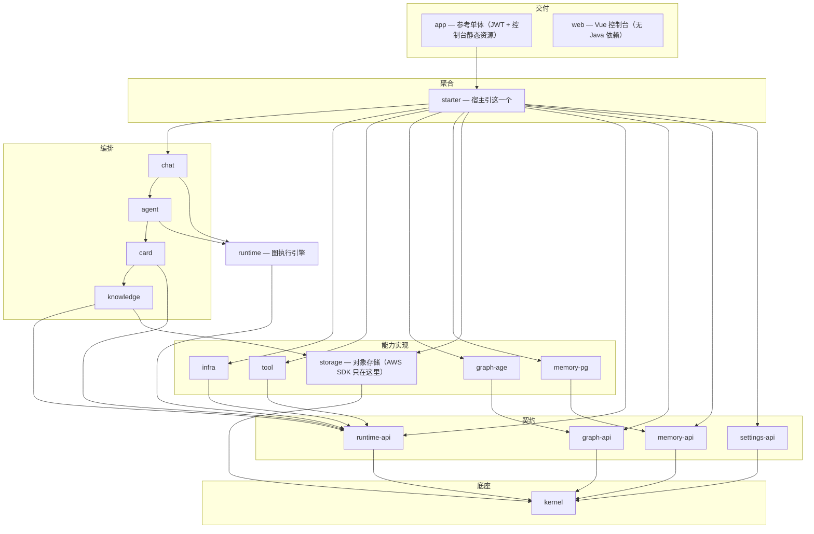

# 架构

本文是模块与依赖的**唯一权威描述**，内容按各模块 `pom.xml` 实际依赖生成。改动模块结构后请同步更新本文件。

## 分层



## 模块依赖表

由各模块 `pom.xml` 生成；括号内为依赖方数量，越多说明越是公共底座。

| 模块 | 依赖 |
| --- | --- |
| `kernel` | 无（被 13 个模块依赖） |
| `settings-api` | 无（被 9 个） |
| `graph-api` / `memory-api` | 无（各被 4 个） |
| `aimodel` | kernel |
| `runtime-api` | kernel |
| `storage` | kernel |
| `graph-age` | graph-api, kernel, settings-api |
| `memory-pg` | graph-api, kernel, memory-api, settings-api |
| `infra` | aimodel, kernel, runtime-api, settings-api |
| `tool` | kernel, runtime-api, settings-api |
| `runtime` | kernel, memory-api, runtime-api, settings-api |
| `knowledge` | aimodel, graph-api, infra, kernel, runtime-api, settings-api, storage |
| `card` | aimodel, infra, kernel, runtime-api, tool |
| `agent` | aimodel, card, kernel, knowledge, runtime, settings-api, tool |
| `chat` | agent, aimodel, card, infra, kernel, knowledge, memory-api, runtime, tool |
| `starter` | 上述全部能力模块 |
| `app` | settings-api, starter |
| `web` | 无（前端） |

## 契约与实现分离

`runtime-api` 只放**契约**：SPI 端口（`ModelPort` / `ToolPort` / `KnowledgePort` / `CardPort` / `HitlPort`）、工具披露 SPI、以及图的值类型（`GraphSpec` / `WorkflowState` / `WorkflowStreamEvent` 等，包 `org.deepstack.ai.engine.api`）。

`runtime` 放**实现**：图编译与执行、节点实现、checkpoint、`RunContext`。

只实现端口的能力模块（`infra` / `tool` / `knowledge` / `card`）依赖 `runtime-api` 即可，编译期不必引入图执行引擎。只有真正编排图的 `agent` 与 `chat` 依赖 `runtime`。

同样的拆分方式也用在图谱与长期记忆上：`graph-api` / `graph-age`、`memory-api` / `memory-pg`。

## 关键约定

### 端口占位

`RuntimeSpiAutoConfiguration` 为未装配的端口提供占位实现，分两类：

- **调用即失败**：`ModelPort`、`ToolPort`、`KnowledgePort`、`HitlPort.resume` —— 宿主配置了对应能力却没引入 Adapter 时抛 `IllegalStateException` 并指明缺失模块。静默返回空会被误读成「检索没命中」「工具没输出」。
- **标记不可用**：`MemoryPort`、`HitlPort.available()` —— 属可选能力，调用方先看 `available()` 再决定是否使用。

### 请求上下文

单次图执行的请求态（user / conversation / thread / 流 sink / 出卡器 / 待确认卡片）在 `RunContext`，由 `WorkflowCompiler` 在执行入口 `install`。

LangGraph 可能把节点调度到安装线程之外，所以：

- `RunContext` 除 ThreadLocal 外还按 `threadId` 建索引，`currentOrThread(threadId)` 可在异步线程上取回；
- 节点包装器（`NodeActionFactory`）用 `RunContext.bound(...)` 把上下文**绑定**到执行线程，覆盖委托调用与完成回调两段；
- 需要用到的值（userId / conversationId / agentCode / threadId）同时写入 `WorkflowState`，节点优先从 state 取，ThreadLocal 仅作兜底。

### 配置三层

| 层 | 存哪 |
| --- | --- |
| 基础设施（数据源、Redis、S3、JWT 密钥） | yml / 环境变量 |
| 资源级（某知识库是否开图、某 Agent 的记忆策略） | 业务表 |
| 运营级（图谱 / 记忆 / MCP / checkpoint / 工具披露 / 配额 / 告警开关） | `sys_config` + Redis 缓存 |

是否类值统一 `0` / `1` 文本，读取用 `SysConfigPort.isYes(key)`。业务总开关不写 `@ConditionalOnProperty`：模块引入即装配，运行时读 sys_config 决定是否干活。

### Agent 是唯一编排入口

Agent 对外标识 `agentCode`，编排方式由 `ai_agent.orchestrate_mode` 决定（`0` CHAT / `1` GRAPH）。图定义在 `ai_agent.graph_definition`（草稿）与 `published_graph_definition`（线上）。调用方只认 Agent。

## 测试

```bash
JAVA_HOME=/path/to/jdk-21 mvn -o test
```

当前覆盖纯逻辑：`ConditionEvaluator`（图条件表达式求值）、`TrajectoryRedactor`（落库前脱敏）、`RunContext`（上下文安装 / 按 threadId 回查 / 绑定还原）。集成行为（图执行、HITL、事务）尚无自动化覆盖，需要真实 PG / Redis / MinIO 环境。

## 已知待改进

- `kernel` 同时承载**契约**（`model` / `exception` / `enums` / 登录 SPI）与**基础设施适配器**（`p6spy`、`mybatis`），并带着 MyBatis-Plus / PostgreSQL / P6Spy / WebMVC 的传递依赖，13 个依赖方都会拿到。对象存储已独立为 `storage`，但 MyBatis / P6Spy 仍在。后续可让各模块**显式声明自己直接使用的依赖**，而不是依赖 `kernel` 的传递依赖（`agent` 的 Redis 就是这么漏掉的）。
- 前端 `GraphEditor.vue` 正在按「纯逻辑 / composable / 子组件」收敛。
- 集成行为（图执行、HITL、事务、并发）没有自动化覆盖，只有纯逻辑单测。
