# AI DeepStack · 项目介绍

> 在 Spring 工程里把 Agent 做成可运营、可审计、可嵌入现有系统的能力。  
> Spring AI × LangGraph4j · Java 21 · 单租户控制台 + 可嵌入依赖

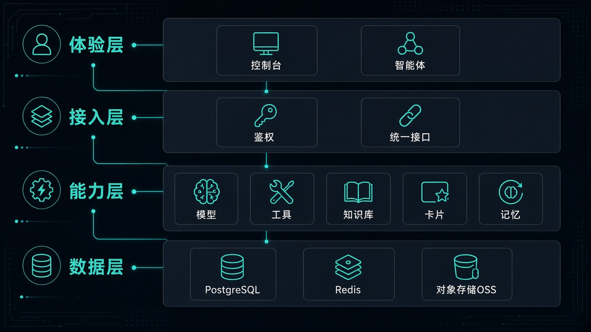

---

## 目录

1. [一句话定位](#1-一句话定位)
2. [为什么需要它](#2-为什么需要它)
3. [解决了什么问题](#3-解决了什么问题)
4. [核心优势](#4-核心优势)
5. [产品模型](#5-产品模型)
6. [详细架构](#6-详细架构)
7. [关键数据流](#7-关键数据流)
8. [生产能力矩阵](#8-生产能力矩阵)
9. [技术选型](#9-技术选型)
10. [两种交付形态](#10-两种交付形态)
11. [边界与非目标](#11-边界与非目标)
12. [快速入口](#12-快速入口)

---

## 1. 一句话定位

AI DeepStack 是面向 Java / Spring 团队的 Agent 平台：以 Agent 为配置与调用的核心，把对话、图编排、工具（含 MCP）、知识库（向量检索，可选图谱增强）、人工确认、运行记录与配额告警，收进同一套可落库、可运营、可嵌进现有工程的运行时。

Agent 在这里是可部署的业务单元：有稳定编码、有版本、有配额、有运行记录、可回滚。

---

## 2. 为什么需要它

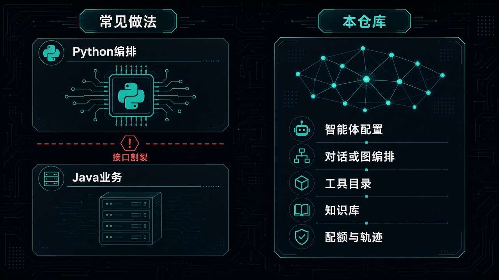

企业落地 Agent 时，常见两条路都容易卡死：

| 路径 | 典型做法 | 隐患 |
| --- | --- | --- |
| 分裂栈 | Python 编排 + Java 业务 HTTP | 鉴权、事务、发布、日志两套；改意图要两边发版；排障对不上 |
| 薄封装 | 业务里直接调大模型接口 | 没有 Agent 配置实体；提示词 / 工具 / 知识库散落；上线缺限流、脱敏、人工确认、版本 |

DeepStack 的立场是：

> Agent 能力长在现有 Java 工程里：同一套登录、同一套库表、同一套发布与审计；编排借鉴 LangGraph 的思想，运行时与运营面留在 Spring。

### 必要性

1. 业务系统已经是 Spring — 再为 Agent 另拉一套 Python 运行时，等于永久双栈。
2. Agent 要进审批 / 写库 — 没有人工确认、断点恢复、运行记录，不敢上生产。
3. 运营要改配置而不是改代码 — 模型、工具、图、开关必须落库 + 控制台。
4. 成本与安全可度量 — 配额、脱敏、告警、节点耗时是上线门槛，不是锦上添花。

---

## 3. 解决了什么问题

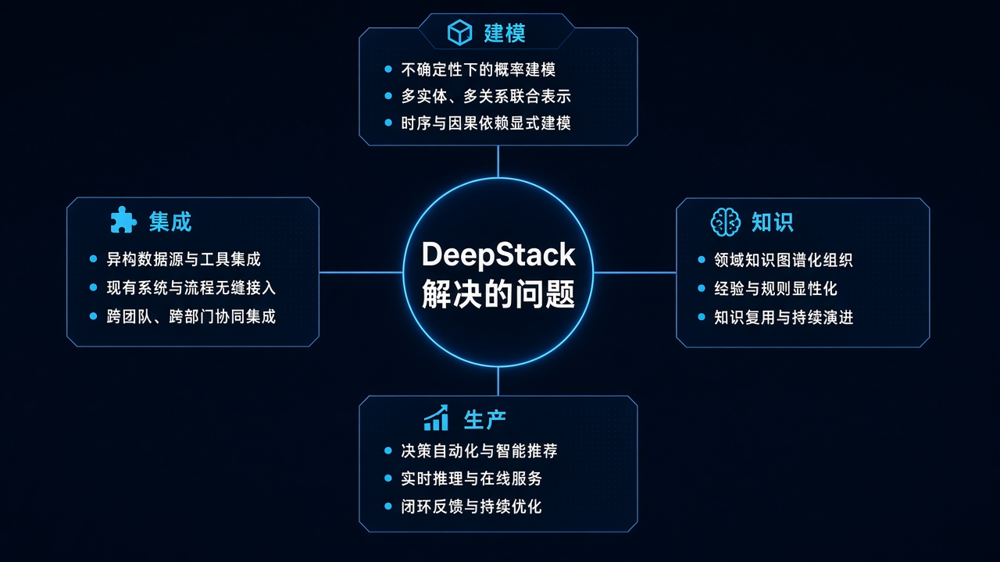

### 对照表

| 痛点 | 没有平台时 | DeepStack |
| --- | --- | --- |
| Prompt / 工具 / 知识库各写各的 | 配置漂移、无法归因 | 全部挂在 `agentCode` |
| 图编排与对话两套入口 | 调用方困惑 | 对话接口只认 Agent 编码，编排方式是配置属性 |
| 外部工具直连进业务代码 | 密钥散落、难审计 | 先同步进工具目录，再按 Agent 绑定 |
| 演示能跑、上线缺件 | 第二期永远排不上 | 脱敏、配额、版本、告警等同仓交付 |
| 换向量库 / 记忆 / 图谱 | 改得到处都是 | 扩展接口 + 独立实现模块 |
| JS 调长整型 ID 精度丢失 | 静默错乱 | API Long 出字符串等约定 |

---

## 4. 核心优势

### 4.1 以 Agent 为中心

调用与配置都围绕 Agent（见 [`ROADMAP.md`](../ROADMAP.md)）：编排方式是 Agent 上的属性（对话或流程图），画布与试跑挂在同一资源下；模型、工具、知识库是平台目录，供多个 Agent 引用；复用靠「复制 Agent」进入新建编辑页。

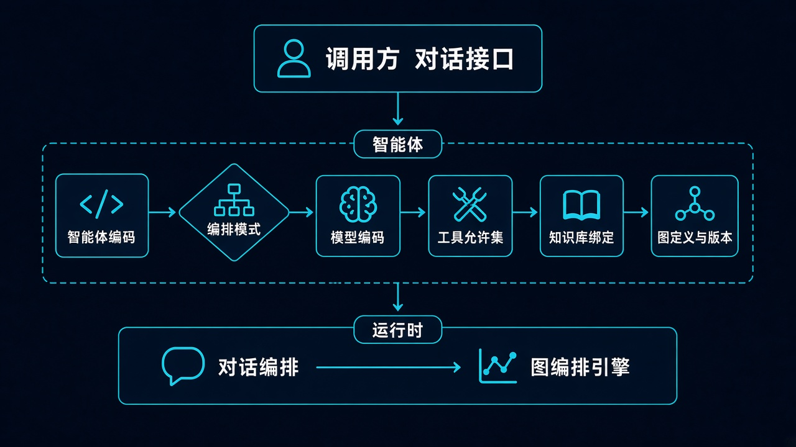

### 4.2 能力可替换，编排不绑死某一种存储

执行层通过扩展接口调用模型、工具、知识、卡片、人工确认、记忆等能力；具体实现放在对应模块。也可以自己实现接口，或直接用聚合依赖自带的实现。

### 4.3 工具先登记，再按 Agent 开通

- 目录里的全部工具，不等于某个 Agent 都能用——以绑定关系为准。  
- 外部工具：先建连接并同步进工具目录，Agent 只勾选工具，不直接绑连接。  
- 工具较多时，可按需分批暴露给模型，避免一次塞入过多说明。

### 4.4 知识：向量检索为主，图谱按需打开

默认向量检索，并可叠加全文检索；在系统与知识库都开启图谱时，入库后异步抽实体写图库，问答时再按关系补充片段。关掉图谱后，行为与纯向量检索一致。详见 [`knowledge-graph-rag.md`](knowledge-graph-rag.md)。

### 4.5 上线能力同仓交付

脱敏、配额、流程版本、人工确认超时、告警、步骤耗时、模型可见范围、评测导出、Agent 用量统计 — 见 [`production-features.md`](production-features.md)。

### 4.6 两种用法

| 形态 | 模块 | 场景 |
| --- | --- | --- |
| 独立部署 | 参考应用 + 控制台 | 内网运营台、试用、演示 |
| 嵌进现有系统 | 聚合依赖包 | 已有 Spring Boot 业务工程 |

---

## 5. 产品模型

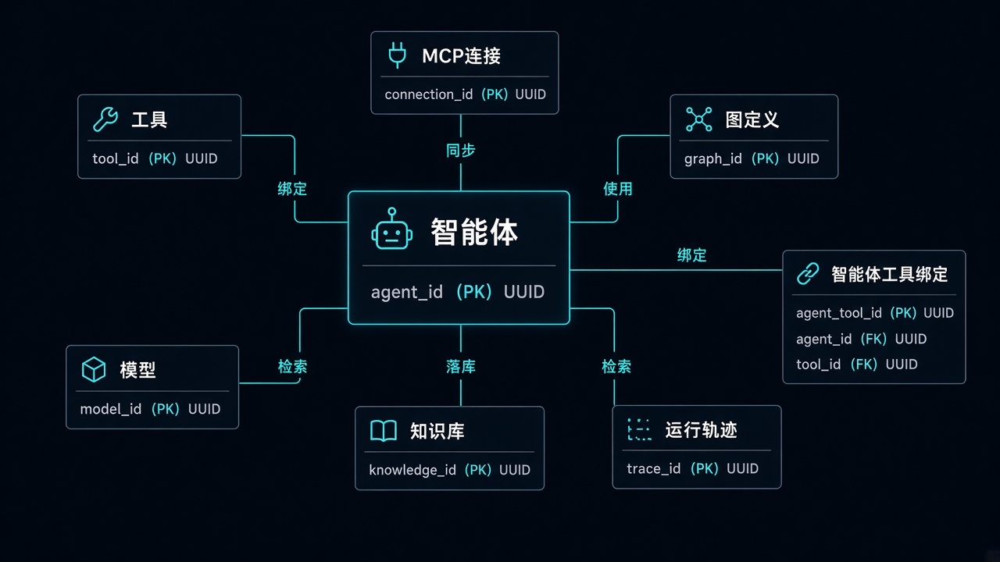

调用方只认 Agent 编码。步骤类型、工具、模型、知识库是平台目录；需要人工确认时，用卡片挂起流程，确认后再继续。

---

## 6. 详细架构

### 6.1 逻辑分层

分层与依赖方向见 [`architecture.md`](architecture.md)（含可渲染的分层图与模块依赖表，按各模块 pom 生成）。

### 6.2 Maven 模块地图

按模块划分与依赖关系见 [`architecture.md`](architecture.md)。下表的职责说明仍适用，但模块数量与依赖以该文档为准。

| 模块 | 职责 |
| --- | --- |
| `kernel` | 响应包装、异常、登录 SPI、分页、枚举 |
| `storage` | S3 兼容对象存储（AWS SDK 只在这里） |
| `settings-api` | `SysConfigPort` / `SysConfigKeys` |
| `aimodel` | 模型配置 CRUD |
| `infra` | 按 `model_code` 建 Chat / Embedding 客户端 |
| `agent` | Agent、图定义、试跑、工具绑定、意图、人工确认恢复 |
| `tool` | 工具目录、MCP 连接与同步 |
| `knowledge` | 知识库、文档、pgvector、GraphRAG 门面 |
| `graph-api` / `graph-age` | 图谱 SPI / Apache AGE |
| `memory-api` / `memory-pg` | 长期记忆 SPI / PG |
| `card` | 对话卡片 |
| `chat` | 对话、短记忆、结构化输出 |
| `runtime-api` | 图契约：SPI 端口、GraphSpec / WorkflowState 等值类型 |
| `runtime` | 图编译执行、节点实现、checkpoint（依赖 runtime-api） |
| `starter` | 宿主聚合依赖 |
| `app` | 参考单体（鉴权、SysConfig 实现等） |
| `web` | Vue 控制台 |

包根：`org.deepstack.ai`。分包细则见 [`core-packages.md`](core-packages.md)。

### 6.3 扩展接口归属

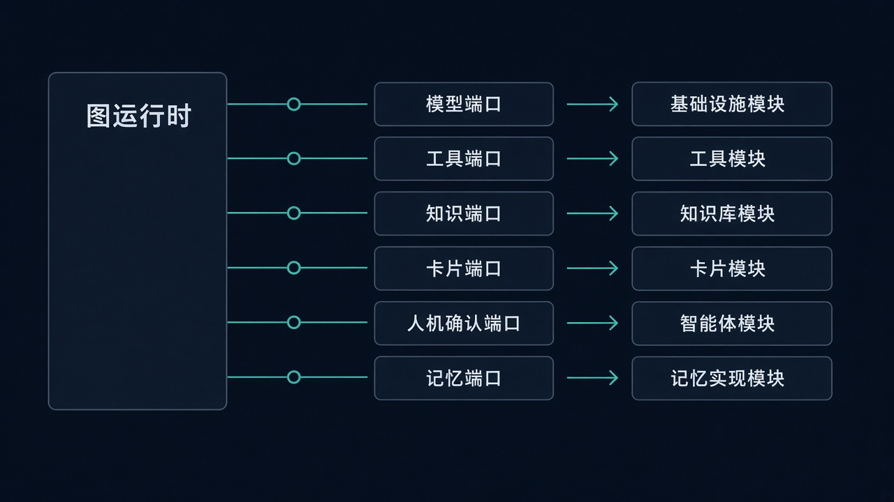

原则：谁提供能力，谁实现对应接口；执行模块在缺少实现时给出可裁剪的空实现，方便按需装配。

---

## 7. 关键数据流

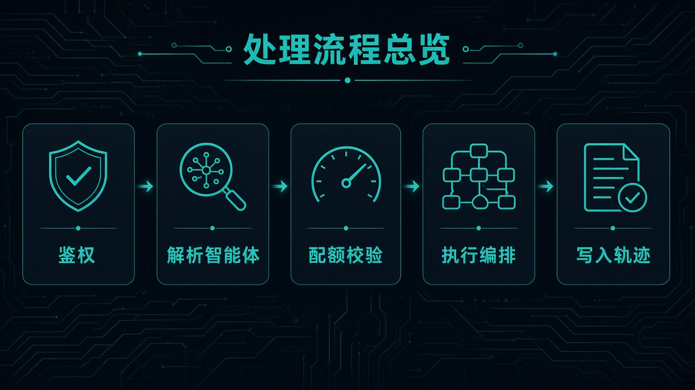

### 7.1 对话主路径

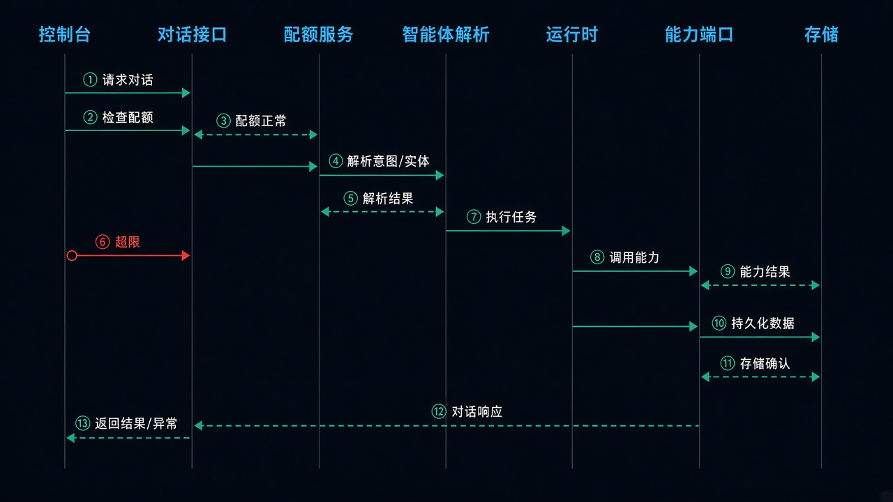

### 7.2 流程图中的人工确认

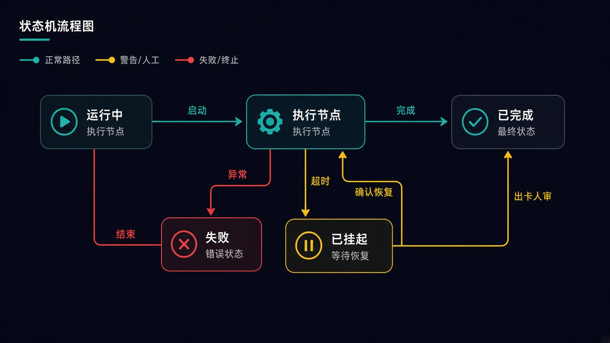

流程可在检查点挂起；前端展示确认卡片，用户确认后从断点继续。

### 7.3 知识入库与召回（含可选图谱）

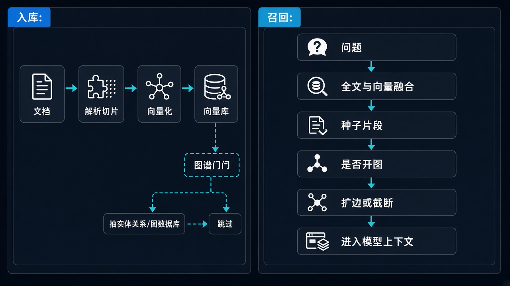

启用图谱需同时满足：系统打开图谱、图库就绪、该知识库勾选启用图谱。详见 [`knowledge-graph-rag-summary.md`](knowledge-graph-rag-summary.md)。

### 7.4 工具与外部连接

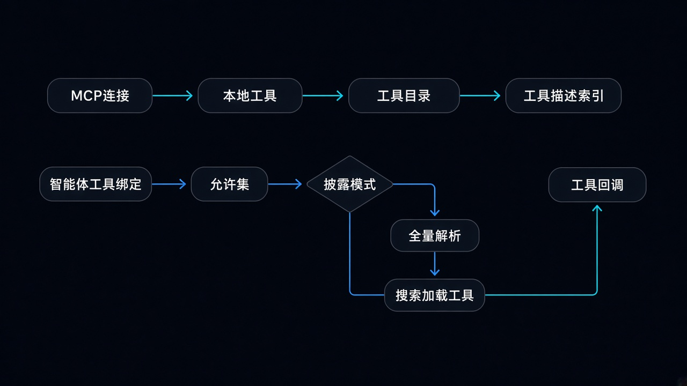

---

## 8. 生产能力矩阵

| 编号 | 能力 | 价值 |
| --- | --- | --- |
| F1 | 轨迹脱敏 | 防手机号 / Key / Bearer 进库 |
| F2 | 限流与配额 | 全站 / Agent / 用户 QPS·并发·日 token |
| F3 | 图版本发布与回滚 | 配置变更可演练、可撤回 |
| F4 | 人工确认超时 | 挂起运行不永久占坑 |
| F5 | 告警 | 失败率 / 超时 / 配额拒绝可感知 |
| F6 | 节点级指标 | 定位慢节点 |
| F7 | Agent 复制 / 子图片段 | 规模化创建 Agent |
| F8 | 评测导出 | 回归与对比 |
| F9 | 公共 / 私有模型 | 密钥可见性治理 |
| F10 | Agent 自身统计 | 运营看用量 |

可观测分层（日志 / 轨迹 / 指标 / Run UI）见 [`agent-observability.md`](agent-observability.md)。运营开关统一走 [`sys-config.md`](sys-config.md)。

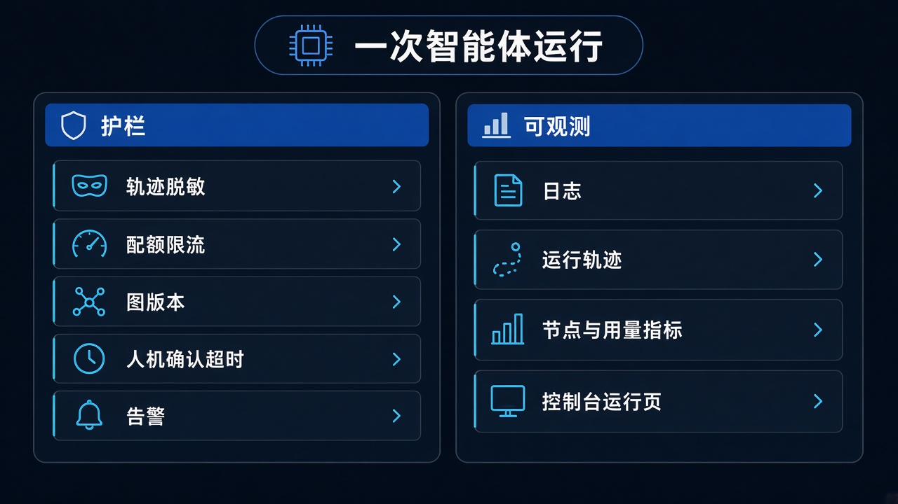

---

## 9. 技术选型

| 层级 | 选型 | 说明 |
| --- | --- | --- |
| 语言 / 运行时 | Java 21 | 与当代 Spring 生态对齐 |
| 应用框架 | Spring Boot 4.1.x | 单体可跑、模块可嵌 |
| 模型接入 | Spring AI 2.x | 按库表 `model_code` 建客户端，非写死 yml |
| 图编排 | LangGraph4j 1.8.x | GRAPH 模式编译执行 |
| 持久化 | PostgreSQL + MyBatis-Plus | schema `deepstack` |
| 向量 | pgvector | 与业务库同实例可运维 |
| 图谱 | Apache AGE（可选） | SPI 可替换 |
| 缓存会话 | Redis | 登录态等 |
| 对象存储 | OSS（S3 兼容协议） | 知识库文档 |
| 控制台 | Vue 3 + Vite | 运维与编排可视化 |
| 业务 JSON | fastjson2 | 与 HTTP Jackson 职责分离 |

不做：多租户 SaaS、绑死某一云厂商、为发 Maven Central 而牺牲内网可跑性（Central 在路线图，非当前阻塞）。

---

## 10. 两种交付形态

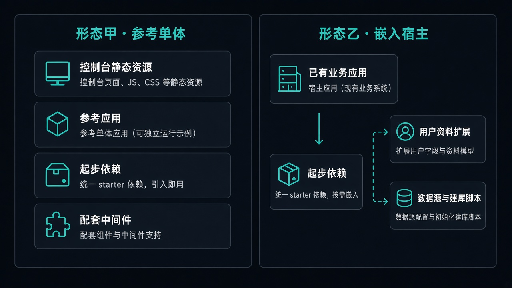

嵌入步骤见系列文 [`articles/08-embed-with-starter.md`](articles/08-embed-with-starter.md)。本地十分钟路径见 [`articles/01-get-started-in-30-minutes.md`](articles/01-get-started-in-30-minutes.md)。

---

## 11. 边界与非目标

| 做 | 不做（当前） |
| --- | --- |
| 单租户控制台 + Starter | 多租户 / 按租户 API Key 计费 |
| Port 级扩展 | 强制替换宿主用户体系 |
| GraphRAG 增强 | 用图替代向量主召回 |
| 生产护栏 F1–F10 | 微服务拆分（按需以后再说） |

---

## 12. 快速入口

| 文档 | 内容 |
| --- | --- |
| [根 README](../README.md) | 安装、环境变量、模块表 |
| [技术文章系列](articles/README.md) | 选型 → 上手 → 专题深读 |
| [core-packages](core-packages.md) | 分包与 Port 归属 |
| [production-features](production-features.md) | F1–F10 |
| [knowledge-graph-rag](knowledge-graph-rag.md) | GraphRAG 设计 |
| [agent-observability](agent-observability.md) | 可观测 |
| [sys-config](sys-config.md) | 运营配置中心 |
| [ROADMAP](../ROADMAP.md) | 产品终态与阶段 |

---

**License：** Apache License 2.0
